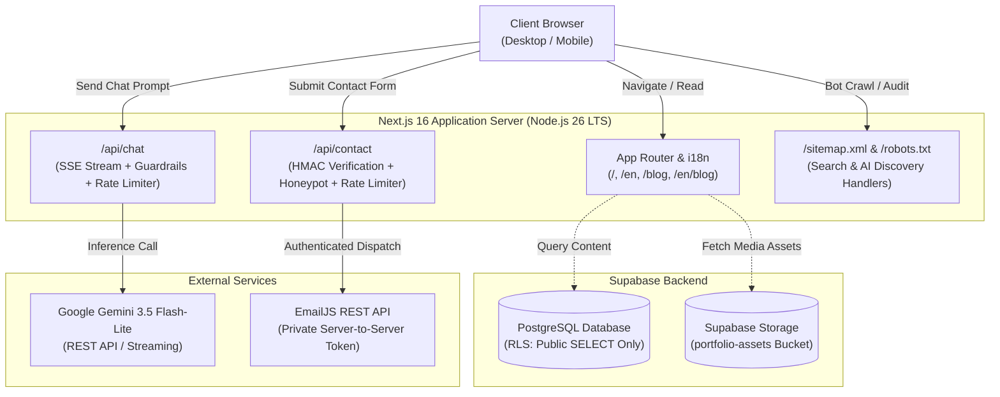

<div align="center">
  
  <h1>Ahmad Meijlan Yasir — Personal Portfolio & Systems Engineering Base</h1>
  <p><strong>Official personal portfolio, bilingual research showcase, and conversational AI platform for Ahmad Meijlan Yasir.</strong></p>

  <p>
    <a href="https://nextjs.org"></a>
    <a href="https://react.dev"></a>
    <a href="https://www.typescriptlang.org"></a>
    <a href="https://nodejs.org"></a>
    <a href="https://tailwindcss.com"></a>
    <a href="https://supabase.com"></a>
    <a href="https://ai.google.dev"></a>
    <a href="https://amymeij.web.id"></a>
  </p>
</div>

---

## Overview

This repository contains the complete source code for the personal engineering portfolio and research hub of **Ahmad Meijlan Yasir** — System Engineer, Meteorology Instrumentation Specialist, and BMKG Researcher (Taruna Sarjana Terapan Instrumentasi MKG at STMKG).

Built on Next.js 16 (App Router with Turbopack), React 19, TypeScript, and Tailwind CSS, the platform showcases peer-reviewed research publications (IEEE, TELKOMNIKA, JoCPES), IoT environmental telemetry pipelines, operational web applications, and technical writing. It features complete bilingual localization (`id` and `en`), an interactive AI assistant powered by Google Gemini 3.5 Flash-Lite with OWASP LLM01 guardrails, a cryptographically signed anti-abuse contact workflow, centralized Supabase media storage, and comprehensive Schema.org SEO/GEO (Generative Engine Optimization).

---

## Key Features

- **Full Bilingual Internationalization (i18n)**:
  - Default Indonesian (`/`) and English (`/en`) routes with static dictionary localization (`messages/id.json`, `messages/en.json`).
  - Seamless route and anchor preservation when switching languages with zero hydration flicker.
  - Independent localized metadata, Open Graph cards, canonical URLs, and `hreflang` alternate links.
- **Next.js 16 App Router & Turbopack**:
  - Leverages React 19 Server Components, Streaming SSR, and Static Site Generation (SSG) for dynamic blog pages (`/blog/[id]` and `/en/blog/[id]`).
- **Signature Editorial Design System**:
  - Purpose-built scientific palette: Signature Pine Green (`#214A40`), Alabaster Canvas (`#F7F7F2`), Atmospheric Lime Accent (`#C7E76A`), Stone Border (`#DEE4DC`), and Foam Light (`#E9EEE8`).
  - Strict typography scale using Plus Jakarta Sans for body/display and JetBrains Mono for telemetry tokens.
  - Fully documented in [DESIGN.md](DESIGN.md).
- **Conversational AI Assistant with OWASP LLM01 Guardrails**:
  - Driven by Google Gemini 3.5 Flash-Lite via Server-Sent Events (SSE) streaming.
  - Multi-tier safety architecture: intent-driven knowledge retrieval, structural XML boundary encapsulation (`<user_query>`), deterministic jailbreak filtering, and output DLP masking.
  - In-memory sliding window rate limiting.
- **Cryptographic Zero-Abuse Contact Dispatch**:
  - Serverless dispatch via `/api/contact` preventing any client-side credential exposure.
  - Server-signed HMAC math challenge with cryptographic expiration timestamps.
  - Invisible honeypot traps to neutralize bot automation.
  - Strict IP rate limiting (maximum 3 requests per 10 minutes) and CRLF header injection sanitization.
- **Centralized Storage & High-Availability Data Layer**:
  - Dynamic media assets stored in Supabase Storage (`portfolio-assets` bucket) pre-optimized as lightweight WebP images.
  - Database access protected with Row-Level Security (RLS) restricting public access to read-only (`SELECT`).
  - Resilient offline fallback layer (`lib/*-data.ts`) ensuring 100% uptime even during network or database maintenance.
- **SEO & Generative Engine Optimization (GEO)**:
  - Multi-entity Schema.org JSON-LD graph (`WebSite`, `ProfilePage`, `Person`, `ItemList`, `Article`, `BreadcrumbList`).
  - Optimized for both traditional search engines (Google, Bing) and AI generative engines (ChatGPT, Perplexity, Gemini, Claude).
  - Native dynamic `/sitemap.xml` and `/robots.txt` granting explicit crawl access to leading AI user-agents.

---

## System Architecture



---

## Tech Stack

| Domain | Technologies & Specifications |
| :--- | :--- |
| **Runtime** | Node.js `v26.13.1` Active LTS (also validated on `v24.22.3+` Maintenance LTS) |
| **Framework** | Next.js 16.4.6 (App Router, Turbopack compiler) |
| **Core Library** | React 19.3.1, React DOM 19.3.1 |
| **Language** | TypeScript 5.9.3 (strict mode) |
| **Styling** | Tailwind CSS 3.4.19, PostCSS 8.5.6, Autoprefixer 10.6.2 |
| **UI Components** | Radix UI Primitives, Lucide React 1.72.0, React Icons 5.7.1 |
| **Motion & FX** | Framer Motion 14.13.0, GSAP 3.15.1 |
| **Localization** | `next-intl` 4.15.1, custom lightweight context provider (`lib/i18n.tsx`) |
| **Database & Storage** | Supabase (`@supabase/supabase-js` 2.119.0, `@supabase/ssr` 0.12.7) |
| **AI Intelligence** | Google Generative AI SDK (`@google/generative-ai` 0.24.1), Gemini 3.5 Flash-Lite |
| **Form Management** | React Hook Form 7.92.0, Zod 4.6.7 validation |
| **SEO & Sitemaps** | Next.js Metadata API, Schema.org JSON-LD, `next-sitemap` 4.2.3 |
| **Linting & Hygiene** | ESLint 9 (`eslint-config-next` 16.4.6 flat configuration) |

---

## Project Structure

```text
myportfolio/
├── app/
│   ├── api/
│   │   ├── chat/                  # AI chat handler with streaming & OWASP guardrails
│   │   └── contact/               # Contact form dispatch & HMAC challenge verification
│   ├── blog/
│   │   ├── [id]/                  # SSG dynamic article detail with Schema.org Article metadata
│   │   ├── layout.tsx             # Blog section layout with BreadcrumbList schema
│   │   ├── page.tsx               # Blog index page
│   │   └── BlogListClient.tsx     # Client-side category filtering and responsive article cards
│   ├── components/                # Domain-specific page sections (Hero, About, Projects, etc.)
│   ├── en/                        # English localized routes (/en, /en/blog, /en/blog/[id])
│   ├── error.tsx                  # Global App Router error boundary
│   ├── globals.css                # Global CSS, design tokens, and dialog position overrides
│   ├── layout.tsx                 # Root layout with WebSite, ProfilePage, and Person schemas
│   ├── loading.tsx                # Page transition skeleton loader
│   ├── not-found.tsx              # Custom branded 404 page
│   ├── page.tsx                   # Main portfolio landing page (Indonesian default)
│   ├── robots.ts                  # Dynamic robots.txt route handler
│   └── sitemap.ts                 # Dynamic sitemap index route handler
├── components/
│   ├── ui/                        # Radix UI / Shadcn accessible design primitives
│   ├── ChatButton.tsx             # Floating "KNOW ME!" AI assistant dialog & triggers
│   ├── ChatbotWrapper.tsx         # Lazy-loaded chatbot mount wrapper
│   └── SkipLink.tsx               # WCAG keyboard skip-to-content navigation link
├── hooks/
│   ├── use-mobile.tsx             # Viewport detection hook
│   └── use-toast.ts               # Toast notification hook
├── lib/
│   ├── blog-data.ts               # Local fallback blog dataset
│   ├── gemini.ts                  # Gemini client, intent retriever, and safety guardrails
│   ├── i18n.tsx                   # Bilingual translation provider & custom useI18n hook
│   ├── project-data.ts            # Local fallback engineering projects dataset
│   ├── publication-data.ts        # Local fallback academic publications dataset
│   ├── security.ts                # HMAC challenge generator, verifier, and IP rate limiter
│   ├── seo-schema.ts              # Centralized Schema.org JSON-LD schema builder
│   ├── supabase.ts                # Resilient Supabase client with offline fallback handling
│   ├── supabase-admin.ts          # Server-only administrative Supabase client
│   ├── timeline-data.ts           # Local fallback professional journey dataset
│   └── utils.ts                   # Class name merger and formatting utilities
├── messages/
│   ├── id.json                    # Complete Indonesian static translation dictionary
│   └── en.json                    # Complete English static translation dictionary
├── public/                        # Static assets, WebP icons, manifest.json, and PWA assets
├── scripts/
│   ├── migrate.js                 # Asset optimization and Supabase Storage migration script
│   ├── migration-summary.json     # Audit log of migrated and optimized media assets
│   └── upload_single_asset.js     # Single asset WebP optimizer and Supabase uploader utility
├── .env.example                   # Environment variable template with security notes
├── .gitignore                     # Industry-standard Git ignore specifications
├── .nvmrc / .node-version         # Pinned Node.js Active LTS version (26.13.1)
├── DESIGN.md                      # Official design system specifications
├── eslint.config.mjs              # ESLint 9 flat configuration
├── next.config.js                 # Next.js compiler settings, image patterns, and HTTP headers
├── package.json                   # Project scripts, dependencies, engines, and overrides
├── tailwind.config.mjs            # Tailwind CSS configuration and theme extensions
└── tsconfig.json                  # TypeScript compiler configuration
```

---

## Environment Variables

Copy `.env.example` to `.env.local` for local development:

```bash
cp .env.example .env.local
```

| Variable | Scope | Description |
| :--- | :--- | :--- |
| `NEXT_PUBLIC_SUPABASE_URL` | Client & Server | Supabase project API endpoint URL. |
| `NEXT_PUBLIC_SUPABASE_ANON_KEY` | Client & Server | Supabase public anonymous API key (constrained by RLS). |
| `SUPABASE_SERVICE_ROLE_KEY` | Server-Side Only | Administrative service role key for administrative operations. |
| `EMAILJS_SERVICE_ID` | Server-Side Only | EmailJS transactional service ID. |
| `EMAILJS_TEMPLATE_ID` | Server-Side Only | EmailJS email template identifier. |
| `EMAILJS_PUBLIC_KEY` | Server-Side Only | EmailJS account public key / user identifier. |
| `EMAILJS_PRIVATE_KEY` | Server-Side Only | EmailJS access token for server-side non-browser API calls. |
| `GEMINI_API_KEY` | Server-Side Only | Google Gemini API key. |
| `GEMINI_MODEL` | Server-Side Only | Gemini model ID (defaults to `gemini-3.5-flash-lite`). |
| `SECURITY_SECRET` | Server-Side Only | Cryptographic secret salt for HMAC math challenges. |
| `NEXT_PUBLIC_SITE_URL` | Client & Server | Production canonical origin (`https://amymeij.web.id`). |

> [!IMPORTANT]
> Never prefix private credentials (`SUPABASE_SERVICE_ROLE_KEY`, `EMAILJS_PRIVATE_KEY`, `GEMINI_API_KEY`, `SECURITY_SECRET`) with `NEXT_PUBLIC_`. Variables starting with `NEXT_PUBLIC_` are baked into client-side JavaScript bundles.

> [!TIP]
> In your EmailJS dashboard (*Account -> Security*), ensure **"Allow EmailJS API for non-browser applications"** is enabled and configure `EMAILJS_PRIVATE_KEY`. This secures your email delivery so only authenticated server requests can trigger emails.

---

## Getting Started

### 1. Prerequisites

- **Node.js**: `v26.13.1` Active LTS (or `v24.22.3+` Maintenance LTS).
- **Package Manager**: `npm` `>=10.9.0` (or `pnpm` / `yarn`).

### 2. Installation

Clone the repository and install dependencies:

```bash
git clone https://github.com/amymeij22/myportfolio.git
cd myportfolio
npm install
```

### 3. Local Development

Start the development server with Turbopack:

```bash
npm run dev
```

Open [http://localhost:3000](http://localhost:3000) in your browser. The English version is accessible at [http://localhost:3000/en](http://localhost:3000/en).

### 4. Quality Checks & Verification

Run strict TypeScript typechecking and linting:

```bash
npm run typecheck
npm run lint
```

### 5. Production Build

Create an optimized production build:

```bash
npm run build
```

This compiles static routes, executes SSG pre-rendering, generates route traces, and runs `next-sitemap` to build production sitemaps.

### 6. Start Production Server

```bash
npm run start
```

---

## Security & Hardening Highlights

> [!NOTE]
> The portfolio incorporates defense-in-depth engineering practices across every layer:

- **Strict HTTP Security Headers**: Configured in `next.config.js`:
  - `X-Frame-Options: SAMEORIGIN` (Clickjacking mitigation).
  - `X-Content-Type-Options: nosniff` (MIME sniffing prevention).
  - `Referrer-Policy: strict-origin-when-cross-origin`.
  - `Permissions-Policy: camera=(), microphone=(), geolocation=()`.
- **Row-Level Security (RLS)**: Both database tables (`projects`, `publications`, `blogs`, `blog_categories`, `timeline`) and the `portfolio-assets` storage bucket are locked to public read-only (`SELECT`). Any write, update, or delete attempt by anonymous or unauthenticated users is rejected at the database level.
- **OWASP LLM01 Guardrails**:
  - Deterministic pre-screening filters known jailbreak patterns before prompt construction.
  - Structural XML boundary tags (`<user_query>`) isolate user inputs from system instructions.
  - Output redaction prevents system prompt and sensitive variable leakage.
- **Server-Side Anti-Abuse**:
  - HMAC signed math challenge validates genuine human submission without intrusive third-party trackers.
  - Honeypot form fields trap automated scrapers silently.
  - In-memory sliding-window IP rate limiting protects server resources.
