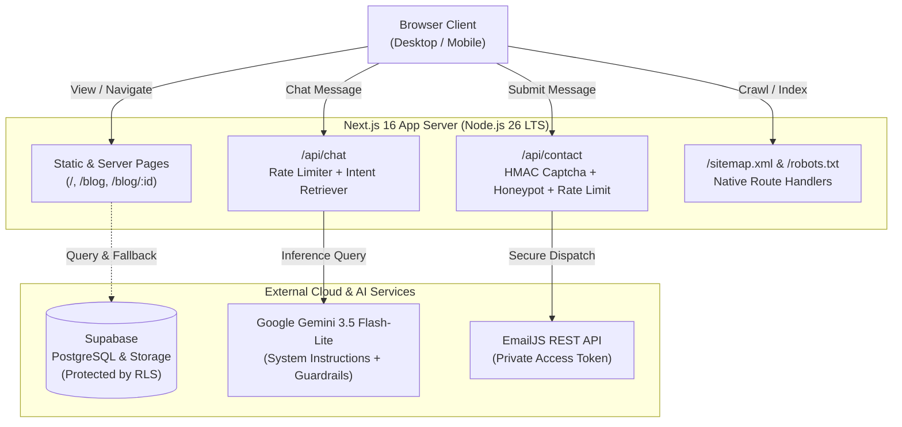

<div align="center">
  
  <h1>Ahmad Meijlan Yasir — Personal Portfolio</h1>
  <p><strong>Official personal portfolio, academic research showcase, and intelligent assistant for Ahmad Meijlan Yasir.</strong></p>

  <p>
    <a href="https://nextjs.org"></a>
    <a href="https://react.dev"></a>
    <a href="https://www.typescriptlang.org"></a>
    <a href="https://nodejs.org"></a>
    <a href="https://tailwindcss.com"></a>
    <a href="https://supabase.com"></a>
    <a href="https://ai.google.dev"></a>
    <a href="https://amymeij.web.id"></a>
  </p>
</div>

---

## Overview

This repository contains the source code for the personal portfolio of **Ahmad Meijlan Yasir** (Taruna Sarjana Terapan Instrumentasi MKG at STMKG). Built with Next.js 16 (App Router + Turbopack), React 19, TypeScript, and Tailwind CSS, the platform showcases research publications (IEEE, TELKOMNIKA, JoCPES), IoT systems, automated weather pipelines, and engineering projects.

It includes an AI chatbot assistant powered by Google Gemini with OWASP LLM01 guardrails, an anti-abuse contact form routing through serverless endpoints, and a structured data architecture for search engine optimization and sitelinks discovery.

---

## Key Features

- **Next.js 16 App Router Architecture (Turbopack)**: Leverages React 19 Server Components, Server-Side Rendering (SSR), and Static Site Generation (SSG) for dynamic blog pages.
- **AI Chatbot with OWASP LLM01 Guardrails**:
  - Semantic RAG-lite retrieval selecting relevant knowledge modules based on user intent.
  - 3-tier defense: deterministic jailbreak pre-screening, structural XML boundary tagging (`<user_query>`), and output DLP redaction.
  - Native multi-turn context retention with token-efficient sliding window.
- **Zero-Abuse Contact System**:
  - Serverless dispatch via `/api/contact` to prevent client-side credential leakage.
  - Cryptographic server-signed HMAC math challenge with timestamp expiration.
  - Honeypot trap to silently capture and neutralize automated bots.
  - Sliding-window IP rate limiter (maximum 3 requests per 10 minutes) and CRLF header injection sanitization.
- **Search Engine Optimization & Google Sitelinks**:
  - Full Schema.org JSON-LD graph (`WebSite`, `ProfilePage`, `Person`, `BreadcrumbList`, and `SiteNavigationElement`).
  - Native dynamic `/sitemap.xml` and `/robots.txt` route generation including all dynamic blog routes.
- **High-Availability Data Layer**:
  - Supabase integration with Row-Level Security (RLS) enforcement.
  - Automatic fallback to local offline dataset if database connectivity is interrupted.
- **Modern UI & Accessibility (a11y)**:
  - Dark/Light mode powered by `next-themes`.
  - Accessible Radix UI primitives and WCAG keyboard SkipLink support.
  - Animations orchestrated with Framer Motion and GSAP.

---

## System Architecture



---

## Tech Stack

| Domain | Technologies & Libraries |
| :--- | :--- |
| **Runtime** | Node.js `v26.13.1` Active LTS (compatible with `v24.22.3+` Maintenance LTS) |
| **Framework** | Next.js 16.4.6 (App Router, Turbopack), React 19.3.1 |
| **Language** | TypeScript 5.9.3 |
| **Styling** | Tailwind CSS 3.4.19, PostCSS 8.5, Autoprefixer 10.6 |
| **UI Components** | Radix UI Primitives, Lucide React 1.x, React Icons 5.7 |
| **Animations** | Framer Motion 14.x, GSAP 3.15 |
| **AI Assistant** | Google Generative AI (Gemini 3.5 Flash-Lite) via REST API |
| **Database & Auth** | Supabase (`@supabase/supabase-js` 2.x, `@supabase/ssr`, PostgreSQL) |
| **Form & Validation** | React Hook Form, Zod 4.6 |
| **Linting & Quality** | ESLint 9 (`eslint-config-next` 16.4.6 flat config), TypeScript strict checks |
| **SEO & Sitemap** | Next.js Metadata API, Schema.org JSON-LD, next-sitemap |

---

## Project Structure

```text
myportfolio/
├── app/
│   ├── api/
│   │   ├── chat/                  # AI Chatbot endpoint with guardrails & rate limiter
│   │   └── contact/               # Contact form dispatch & HMAC challenge endpoints
│   ├── blog/
│   │   ├── [id]/                  # SSG dynamic blog detail with generateMetadata
│   │   ├── layout.tsx             # Blog section layout with BreadcrumbList schema
│   │   └── page.tsx               # Blog index page with category filtering
│   ├── components/                # Domain-specific page components (Hero, About, etc.)
│   ├── error.tsx                  # Global error boundary component
│   ├── globals.css                # Global Tailwind CSS and design tokens
│   ├── layout.tsx                 # Root layout, theme provider, and WebSite schema
│   ├── loading.tsx                # Page transition skeleton loader
│   ├── not-found.tsx              # Custom branded 404 page
│   ├── page.tsx                   # Main portfolio landing page
│   ├── robots.ts                  # Native robots.txt route handler
│   └── sitemap.ts                 # Native sitemap.xml dynamic generator
├── components/
│   ├── ui/                        # Radix UI / Shadcn accessible design system
│   ├── ChatButton.tsx             # Floating chat assistant interface
│   ├── ChatbotWrapper.tsx         # Lazy-loaded chatbot mount wrapper
│   ├── SkipLink.tsx               # A11y keyboard skip navigation link
│   └── theme-provider.tsx         # Dark/Light theme context provider
├── hooks/
│   ├── use-mobile.tsx             # Responsive viewport detection hook
│   └── use-toast.ts               # Toast notification state hook
├── lib/
│   ├── blog-data.ts               # High-availability local fallback blog dataset
│   ├── gemini.ts                  # Modular RAG retriever & OWASP guardrails
│   ├── security.ts                # Cryptographic HMAC challenge & rate limiter utilities
│   ├── supabase.ts                # Resilient Supabase client with local fallback
│   ├── supabase-admin.ts          # Server-only administrative Supabase client
│   └── utils.ts                   # Class variance and utility helpers
├── public/                        # Optimized icons, manifest.json, and PWA assets
├── .env.example                   # Environment variable template with security notes
├── .nvmrc / .node-version         # Pinned CVE-free Node.js Active LTS version (26.13.1)
├── eslint.config.mjs              # ESLint 9 + eslint-config-next flat configuration
├── next.config.js                 # Next.js compiler, image patterns, and HTTP headers
├── package.json                   # Project dependencies, overrides, engines, and scripts
├── tailwind.config.mjs            # Tailwind CSS ESM configuration
└── tsconfig.json                  # TypeScript compiler options
```

---

## Prerequisites

- **Node.js**: `v26.13.1` Active LTS (recommended) or `v24.22.3`+ Maintenance LTS (CVE-patched releases).
- **Package Manager**: `npm` `>=10.9.0`, `pnpm`, or `yarn`.
- **API Keys**:
  - Google Gemini API Key from [Google AI Studio](https://aistudio.google.com/).
  - Supabase Project URL & Anon Key from [Supabase Dashboard](https://supabase.com/).
  - EmailJS Service ID, Template ID, and Public Key from [EmailJS](https://dashboard.emailjs.com/).

---

## Environment Variables

Copy `.env.example` to `.env.local` for local development:

```bash
cp .env.example .env.local
```

| Variable | Scope | Description |
| :--- | :--- | :--- |
| `NEXT_PUBLIC_SUPABASE_URL` | Public / Client | Supabase project endpoint URL. |
| `NEXT_PUBLIC_SUPABASE_ANON_KEY` | Public / Client | Supabase anonymous API key (constrained by RLS). |
| `SUPABASE_SERVICE_ROLE_KEY` | Server-Side Only | Administrative secret key for Supabase. |
| `EMAILJS_SERVICE_ID` | Server-Side Only | EmailJS service identifier. |
| `EMAILJS_TEMPLATE_ID` | Server-Side Only | EmailJS email template identifier. |
| `EMAILJS_PUBLIC_KEY` | Server-Side Only | EmailJS account public key / user ID. |
| `EMAILJS_PRIVATE_KEY` | Server-Side Only | Optional EmailJS access token for server lockdown. |
| `GEMINI_API_KEY` | Server-Side Only | Google Gemini API key. |
| `GEMINI_MODEL` | Server-Side Only | Optional Gemini model ID (default: `gemini-3.5-flash-lite`). |
| `SECURITY_SECRET` | Server-Side Only | Random secret salt for cryptographic HMAC challenges. |
| `NEXT_PUBLIC_SITE_URL` | Public / Client | Canonical URL (`https://amymeij.web.id`). |

> [!IMPORTANT]
> Never prefix secret keys (`SUPABASE_SERVICE_ROLE_KEY`, `EMAILJS_PRIVATE_KEY`, `GEMINI_API_KEY`) with `NEXT_PUBLIC_`. Variables with `NEXT_PUBLIC_` are exposed in browser bundles.

> [!TIP]
> In EmailJS settings (*Account -> Security*), enable **"Require Access Token"** and set `EMAILJS_PRIVATE_KEY`. This ensures all external requests originating outside your server are completely rejected.

---

## Getting Started

### 1. Install Dependencies

```bash
npm install
```

### 2. Run the Development Server

```bash
npm run dev
```

Open [http://localhost:3000](http://localhost:3000) in your browser.

### 3. Build for Production

```bash
npm run build
```

This compiles static pages, creates optimized traces, runs SSG pre-rendering, and generates the production sitemap.

### 4. Start the Production Server

```bash
npm run start
```

---

## Security & Hardening Highlights

> [!NOTE]
> The portfolio codebase incorporates security controls aligned with industry standards:

- **HTTP Security Headers**: Configured in `next.config.js`:
  - `X-Frame-Options: SAMEORIGIN` (Clickjacking prevention).
  - `X-Content-Type-Options: nosniff` (MIME sniffing prevention).
  - `Referrer-Policy: strict-origin-when-cross-origin`.
  - `Permissions-Policy: camera=(), microphone=(), geolocation=()`.
- **Rate Limiting**: Sliding-window in-memory throttling on `/api/chat` (12 req/min) and `/api/contact` (3 req/10 min).
- **Honeypot Protection**: Hidden input fields filter automated crawlers before executing email services.
- **Prompt Injection Defense**: Multi-tier filtering preventing system prompt extraction, unauthorized persona hijacking, and out-of-scope queries.
- **Row-Level Security Guard**: The client layer only executes read-only operations against Supabase; mutations require administrative validation.
